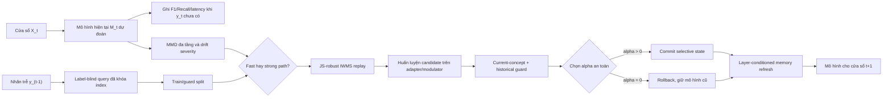
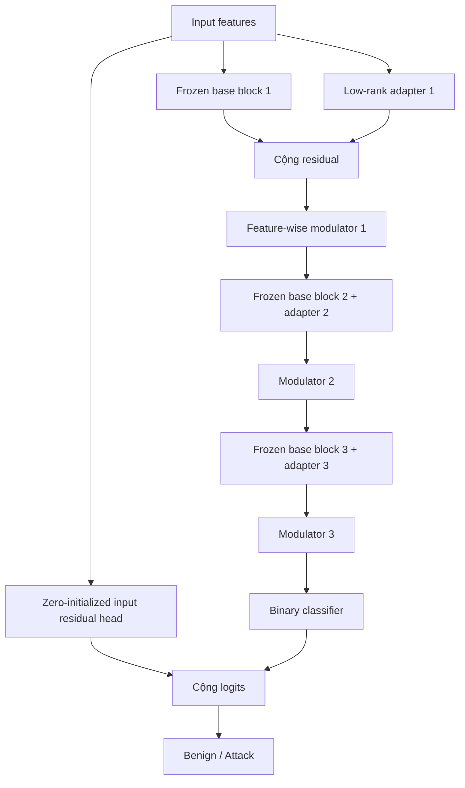

# Đề cương nghiên cứu DASP phiên bản hiện tại

## Thông tin cốt lõi

- **Tên trong bài báo:** DASP
- **Phiên bản triển khai hiện tại:** V18
- **Bài toán:** Binary streaming NIDS, `Benign` và `Attack`
- **Ràng buộc trung tâm:** Không cập nhật toàn bộ backbone sau warm-up
- **Luận điểm nghiên cứu:** DASP phân bổ plasticity đúng nơi, đúng thời điểm và
  chỉ commit mức thay đổi an toàn thay vì fine-tune toàn bộ mạng khi drift
- **Trạng thái:** Cơ chế đã triển khai và kiểm thử; full benchmark chưa hoàn tất
- **Ngày cập nhật:** 2026-07-27

## 1. Tên đề tài

### Tiếng Việt

**DASP: Cập nhật chọn lọc theo lớp để thích nghi trôi khái niệm trong hệ thống
phát hiện xâm nhập mạng trực tuyến**

### Tiếng Anh

**DASP: Selective Layer-Wise Adaptation to Concept Drift in Streaming Network
Intrusion Detection**

Trong tiêu đề này, “cập nhật chọn lọc theo lớp” là cập nhật các adapter và
modulator gắn với từng lớp representation. Nó không có nghĩa là mở lại toàn bộ
trọng số của base layers. Ràng buộc đóng băng backbone được trình bày trong
phương pháp và phần đóng góp, không dùng làm thông điệp chính của tiêu đề.

## 2. Trọng tâm thật sự của nghiên cứu

Nghiên cứu không chỉ đề xuất thêm một drift detector hoặc một replay buffer.
Trọng tâm là một **cơ chế thích nghi có kiểm soát** gồm ba quyết định liên tiếp:

1. **Có cần tăng plasticity hay không?**
2. **Nhóm tham số nhỏ nào được phép thay đổi và thay đổi mạnh đến đâu?**
3. **Candidate sau cập nhật có đủ an toàn để thay thế mô hình đang chạy không?**

DASP xử lý ba quyết định đó bằng một chuỗi cơ chế:

`fused prediction → cheap input gate → conditional layer-MMD →
label-blind query → robust replay → selective candidate training →
class-safe soft commit → bounded memory refresh`.

Ở cửa sổ ổn định, DASP không chạy gradient. Mô hình chỉ nhận tối đa 64 nhãn
được chọn không nhìn nhãn để làm mới reservoir và guard history. Active query
256 nhãn, IWMS và candidate training chỉ chạy khi có warning, drift,
recurrence hoặc sampled delayed-performance decline.

Backbone chỉ được huấn luyện trong warm-up. Sau đó DASP chỉ sử dụng low-rank
adapters, input residual head, feature-wise modulators và classifier. Cơ chế
guard có quyền giảm mức cập nhật hoặc rollback hoàn toàn.

Để giảm inference latency, DASP duy trì một **fused inference cache**. Low-rank
delta và feature modulation đã commit được gộp đại số vào các Linear kế tiếp
trong một bản sao chỉ dùng dự đoán. Mô hình học gốc vẫn giữ adapter tách rời,
backbone đóng băng và là state duy nhất được audit; fused cache không nhận
gradient và được tái tạo sau commit.

Điểm nghiên cứu cần chứng minh không phải “DASP có nhiều module hơn”, mà là:

> Việc kết hợp trigger có độ trễ, truy vấn nhãn không leakage, replay chống
> pseudo-class collapse, parameter-efficient plasticity và prequential guard
> có tạo khả năng phục hồi drift tốt hơn trong khi giữ
> `global_update_count = 0` hay không?

## 3. Khoảng trống mà DASP giải quyết

### 3.1 Static model thiếu plasticity

Mô hình offline ổn định nhưng không thay đổi khi distribution và attack
campaign biến đổi. Hiệu năng có thể suy giảm mạnh tại first drift.

### 3.2 Whole-model fine-tuning quá rộng

Fine-tune toàn mạng có thể phục hồi nhanh nhưng:

- thay đổi representation ở mọi tầng;
- tăng catastrophic forgetting;
- tốn compute và update latency;
- khó giải thích chính xác tham số nào đã đổi;
- tăng rủi ro khi triển khai online.

### 3.3 Selective update có thể quá yếu

Chỉ mở một classifier hoặc adapter rank nhỏ giúp ổn định nhưng có thể không đủ
plasticity khi drift tác động nhiều tầng. Đây chính là nguyên nhân thiết kế hai
đường `fast` và `strong` trong DASP.

### 3.4 Replay có thể bị dẫn sai bởi mô hình đang lỗi

Feature-similarity replay thường dựa vào pseudo-class hoặc confidence hiện tại.
Tại first drift, classifier có thể collapse về lớp đa số. Khi đó replay tiếp
tục chọn dữ liệu theo một pseudo-distribution sai và làm chậm phục hồi.

### 3.5 Active query có thể leakage

Nếu chọn “class-balanced samples” sau khi đã nhìn nhãn của toàn cửa sổ thì
benchmark không còn causal. DASP phải chọn index trước, sau đó mới được
dereference tối đa 256 nhãn.

### 3.6 Candidate tốt theo loss chưa chắc an toàn

Cross-entropy giảm không bảo đảm Macro-F1 và Attack Recall tăng. Candidate có
thể cải thiện lớp Benign nhưng làm hỏng lớp Attack. Vì vậy DASP dùng
class-balanced guard và line search theo mức commit.

## 4. Kiến trúc tổng thể DASP

### 4.1 Backbone

Backbone là MLP:

`input → 256 → 128 → 64 → binary classifier`.

Sau warm-up:

- `blocks.*` bị đóng băng;
- `v17_strong_base_layers = 0`, nên strong path hiện tại cũng không mở base
  layer;
- adapter, input residual head, modulator và classifier là các nhóm thích nghi;
- mọi thay đổi được log theo parameter group.

### 4.2 Thành phần trainable

## 5. Cơ chế 1 — Low-rank selective adapters

Mỗi hidden layer có một residual adapter low-rank. Thay vì cập nhật ma trận
trọng số nền lớn, adapter học một hiệu chỉnh hạng thấp:

$$
h_{\ell} =
f_{\ell}^{base}(h_{\ell-1})
+ A_{\ell}^{up}A_{\ell}^{down}h_{\ell-1}.
$$

Base path giữ nguyên; chỉ residual path thích nghi. Rank hoạt động quyết định
dung lượng plasticity:

- fast path dùng trainable rank 4;
- strong path dùng trainable rank 32;
- active rank không bị giảm khi model đã tích lũy adapter rank cao hơn;
- inactive rank columns không bị thay đổi bởi AdamW weight decay.

### Vai trò

- tạo plasticity theo từng tầng;
- giảm số tham số cần cập nhật;
- giới hạn interference so với whole-model fine-tuning;
- cho phép tăng capacity tại strong drift mà không phá invariant.

### Claim cần kiểm chứng

DASP phải phục hồi tốt hơn mô hình chỉ cập nhật classifier nhưng có forgetting
thấp hơn full fine-tuning.

## 6. Cơ chế 2 — Raw-input residual head

Một nhánh MLP nhỏ đi trực tiếp từ raw input đến binary logits:

$$
z = z_{backbone} + z_{input\_adapter}.
$$

Lớp cuối của input adapter được khởi tạo bằng 0. Do đó trước adaptation:

$$
z_{input\_adapter}=0,
$$

và DASP không làm thay đổi prediction ban đầu.

### Vai trò

Khi representation của frozen backbone không còn tách được Benign và Attack,
input residual head tạo một đường quyết định mới mà không cần sửa base feature
extractor.

### Rủi ro

Nhánh này có thể học shortcut theo drift window hiện tại. Historical guard và
memory-gradient protection phải ngăn shortcut làm hỏng concept cũ.

## 7. Cơ chế 3 — Feature-wise residual modulation

Sau mỗi hidden layer, DASP áp dụng:

$$
h' = h \odot \left(1+s\tanh(g)\right)+s\tanh(b),
$$

trong đó:

- $g$ là vector gain;
- $b$ là vector bias;
- $s=0.5$ là modulation scale hiện tại;
- $g=b=0$ tại khởi tạo.

Đây là phép điều chỉnh từng feature sau hidden transformation. `tanh` chặn
biên độ, vì vậy mỗi feature không thể bị scale hoặc dịch chuyển vô hạn.

### Plasticity hiện tại

- fast path: modulation plasticity `0,5`;
- strong path: modulation plasticity `1,0`.

### Vì sao cơ chế này quan trọng

Low-rank adapter thay đổi residual transformation trước các operation còn lại.
Modulator tác động trực tiếp vào representation cuối của từng block. Nó tạo
khả năng sửa feature amplitude/offset khi frozen normalization và base weights
không còn phù hợp với concept mới.

## 8. Cơ chế 4 — Trigger hai nguồn

DASP không dựa duy nhất vào drift detector. Strong adaptation được kích hoạt
bởi một trong ba nguồn:

1. multilevel MMD detector;
2. delayed-performance decline;
3. recurrence signal.

### 8.1 Multilevel MMD detector

Detector theo dõi representation ở nhiều hidden layers. Cấu hình hiện tại:

- MMD samples: 192;
- calibration windows: 4;
- `kappa = 2,0`;
- severity threshold: 0,15;
- emergency threshold: 0,60;
- persistence: 2;
- top-k layers: 2.

MMD xác định **khi nào distribution thay đổi** và layer nào chịu shift mạnh.
Nó không tự chứng minh prediction boundary đã hỏng.

### 8.2 Delayed-performance trigger

Sau khi nhãn của cửa sổ trước xuất hiện, DASP tính Macro-F1 và Attack Recall
trên delayed guard. Reference là median của tối đa năm cửa sổ lịch sử ổn định.

Strong event xảy ra khi:

- có ít nhất bốn reference windows; và
- Macro-F1 giảm ít nhất 0,08; hoặc
- Attack Recall giảm ít nhất 0,08.

Cooldown hiện tại là hai cửa sổ.

### 8.3 Recurrence trigger

DASP theo dõi khoảng cách rời concept anchor và quay lại anchor:

- departure threshold: 0,25;
- return threshold: 0,05;
- anchor interpolation strength: 0,25.

Khi recurrence xảy ra, candidate được soft-reset một phần về anchor model trước
khi học delayed concept mới.

### Ý nghĩa của trigger hai nguồn

- MMD bắt thay đổi feature trước khi có đủ nhãn;
- delayed performance xác nhận thay đổi có hại;
- recurrence dùng tri thức cũ khi concept quay lại;
- strong update không phụ thuộc hoàn toàn vào một threshold feature duy nhất.

## 9. Cơ chế 5 — Label-blind prototype-aware acquisition

DASP chỉ được dùng tối đa 256 nhãn thật mỗi cửa sổ. Index truy vấn được khóa
trước khi đọc `y`.

### 9.1 Query score

Với mẫu $x_i$, điểm truy vấn là:

$$
q_i =
\frac{
w_H H_i + w_N N_i + w_D D_i
}{
w_H+w_N+w_D
},
$$

trong đó:

- $H_i$: normalized predictive entropy;
- $N_i$: novelty so với labeled-memory centroid gần nhất;
- $D_i$: classifier-prototype disagreement;
- $w_H=0.5$;
- $w_N=0.5$;
- $w_D=0.25$.

### 9.2 Novelty

Feature cuối được chuẩn hóa. Với centroid gần nhất $c_k$:

$$
N_i = \mathrm{clip}\left(\frac{1-\cos(h_i,c_k)}{2},0,1\right).
$$

### 9.3 Prototype disagreement

Classifier prediction có thể collapse về Benign hoặc Attack. DASP tạo một
pseudo-view thứ hai bằng class centroid trong labeled memory. Nếu classifier và
prototype view không đồng ý, mẫu nhận thêm query priority.

### 9.4 Diversity-aware global pool

Candidate pool có kích thước tối đa `4 × query budget`. Khoảng 50% query budget
được chọn bằng greedy utility:

$$
u_i = 0.5q_i + 0.5d_i,
$$

trong đó $d_i$ là khoảng cách nhỏ nhất tới các mẫu đã chọn. Cơ chế này tránh
việc top uncertainty chỉ lấy nhiều mẫu gần như trùng nhau.

### 9.5 Prototype-spread remainder

50% quota còn lại được trải theo các prototype classes hiện có. Nếu classifier
collapse nhưng memory centroids vẫn phân tách hai lớp, quota vẫn có khả năng
đưa mẫu từ cả Benign và Attack vào query.

### Khác biệt fairness

Budget-matched baselines có trần 256 index uniform trước khi đọc nhãn. DASP
dùng 64 index uniform label-blind ở stable path và active query tối đa 256 khi
adaptation gate mở. Đây là label-budget cap, không phải yêu cầu mọi phương
pháp phải tiêu hết ngân sách. Không phương pháp nào được class-balance bằng
ground-truth của toàn cửa sổ.

## 10. Cơ chế 6 — Current-concept train/guard split

Chỉ trên adaptation path, sau khi tối đa 256 nhãn đã được nhận, DASP chia
query thành:

- khoảng 75% candidate training;
- khoảng 25% current-concept holdout;
- tối thiểu tám guard samples/lớp khi số mẫu cho phép.

Split bảo đảm mỗi lớp quan sát được vẫn còn ít nhất một mẫu cho training nếu có
thể. Candidate tuyệt đối không được đánh giá trên mẫu vừa dùng để huấn luyện.

### Tại sao cần current-concept holdout

Historical memory chỉ trả lời “candidate có quên quá khứ không?”. Nó không trả
lời “candidate có thực sự sửa được concept vừa drift không?”. Current holdout
cung cấp delayed evidence đúng từ concept đang cần phục hồi.

## 11. Cơ chế 7 — Drift-robust IWMS replay

IWMS dùng feature similarity giữa current unlabeled query và historical
memory. Tuy nhiên similarity quota có thể sai khi prediction confidence thấp.

DASP đo Jensen–Shannon divergence:

$$
JS(P_{current}^{pseudo}\parallel P_{memory}^{label}).
$$

### Cơ chế điều chỉnh

- uniform mix cơ sở: 0,25;
- uniform mix tối đa: 0,75;
- JS threshold: 0,10;
- confidence power: 1,0;
- similarity temperature: 0,10.

Khi confidence thấp hoặc JS divergence lớn, effective uniform mix tăng. Replay
khi đó bớt phụ thuộc pseudo-class distribution và lấy thêm memory samples theo
uniform/class coverage.

### Fast và strong replay

- fast path: tối đa 256 replay samples;
- strong path: tối đa 512 replay samples;
- current unlabeled query dùng tối đa 512 samples để đo similarity.

### Claim cơ chế

Robust mixing phải cải thiện first-drift recovery so với IWMS có uniform mix cố
định, đặc biệt khi classifier ban đầu dự đoán lệch mạnh về một lớp.

## 12. Cơ chế 8 — Surprise và inverse-frequency weighting

Delayed labeled samples không được xem quan trọng như nhau. DASP tăng trọng số
cho:

- mẫu có loss/surprise cao dưới mô hình hiện tại;
- mẫu thuộc lớp có tần suất thấp trong query.

Base new-sample weight:

- fast path: 3,0;
- strong path: 6,0;
- class-weight multiplier tối đa: 2,0.

Cơ chế này hướng update vào các mẫu mà mô hình đang thất bại, đồng thời hạn chế
việc lớp đa số thống trị gradient.

## 13. Cơ chế 9 — Selective candidate training có gradient protection

DASP huấn luyện candidate bằng AdamW theo từng parameter group. Learning rate
nhóm $j$ phụ thuộc plasticity $p_j$:

$$
\eta_j =
\eta_{base}
\times
\left[
\eta_{floor}
+\left(\eta_{ceiling}-\eta_{floor}\right)p_j
\right].
$$

Nhóm có $p_j=0$ bị loại khỏi optimizer khi `strict_freeze=True`.

### Memory-gradient protection

Với:

- $g_n$: gradient trên delayed new concept;
- $g_m$: gradient trên replay memory;

nếu $g_n^\top g_m < 0$, DASP điều chỉnh:

$$
\tilde g_n =
g_n -
(1-p_j)
\frac{g_n^\top g_m}{\left\|g_m\right\|_2^2+\epsilon}g_m.
$$

Khi plasticity thấp, protection mạnh hơn. Khi plasticity gần 1, candidate được
phép ưu tiên concept mới hơn.

### Ý nghĩa

Đây là cơ chế stability–plasticity ở mức gradient:

- replay đưa concept cũ vào quá trình học;
- projection giảm conflict;
- plasticity quyết định mức bảo vệ;
- adapter/modulator giới hạn không gian tham số có thể đổi.

## 14. Cơ chế 10 — Fast path và strong path

| Thành phần | Fast/light path | Strong path |
|---|---:|---:|
| Trainable adapter rank | 4 | 32 |
| Epochs | 1 | 2 |
| Replay size | 128 | 256 |
| New-sample weight | 3 | 6 |
| Input adapter plasticity | 1,0 | 1,0 |
| Modulation plasticity | 0,5 | 1,0 |
| Strong recovery horizon | Không áp dụng | 5 cửa sổ |
| Base layers mở lại | 0 | 0 |

### Fast path

Fast path chỉ được tạo khi cheap gate cảnh báo nhưng chưa có strong event.
Cửa sổ ổn định chỉ refresh memory/guard, không clone candidate và không chạy
backpropagation.

### Strong path

Khi detector, performance drop hoặc recurrence kích hoạt, strong path duy trì
capacity cao trong tối đa năm cửa sổ phục hồi. Strong path vẫn chỉ cập nhật
adapter/modulator/input head/classifier.

### Lý do tồn tại hai path

- chỉ strong-on-drift có thể bỏ lỡ gradual/minority drift;
- chỉ fast update có thể thiếu plasticity tại abrupt drift;
- event gate tránh cập nhật nền không cần thiết nhưng vẫn tăng capacity khi có
  warning hoặc strong event.

## 15. Cơ chế 11 — Class-safe soft commit

Candidate không được commit toàn bộ ngay lập tức. DASP thử tối đa hai hệ số:

$$
\alpha \in
\{1,\;0.5\}.
$$

State thử nghiệm:

$$
\theta_{\alpha}
=(1-\alpha)\theta_{old}+\alpha\theta_{candidate},
$$

nhưng phép nội suy chỉ áp dụng trên các parameter groups được phép thích nghi.
Frozen backbone không bị nội suy.

### Guard endpoints

Mỗi $\alpha$ được so với fallback model trên:

1. current-concept holdout;
2. bounded historical guard;
3. Macro-F1;
4. Attack Recall;
5. minimum per-class recall;
6. mean loss delta.

Tolerance hiện tại:

- Macro-F1: không được giảm;
- Attack Recall: tối đa `-0,01`;
- minimum per-class recall: tối đa `-0,01`;
- recent mean loss tolerance: `0,02`;
- historical memory mean tolerance: `0,02`.

DASP chọn $\alpha$ lớn nhất thỏa guard. Nếu không có $\alpha$ an toàn:

$$
\alpha=0,
$$

candidate bị rollback.

### Vì sao soft commit tốt hơn accept/reject nhị phân

Một candidate có hướng update đúng nhưng bước quá lớn có thể bị hard guard loại
bỏ. Line search cho phép giữ một phần lợi ích bằng bước nhỏ hơn mà vẫn thỏa
Recall/forgetting constraints.

## 16. Cơ chế 12 — Layer-conditioned memory refresh

Memory có capacity 5.000. Sau commit decision, DASP:

1. dùng toàn bộ 256 queried labeled samples, gồm cả holdout đã không tham gia
   candidate training;
2. xác định tối đa hai layer có drift requirement cao;
3. chấm old/new samples theo novelty, class balance và redundancy;
4. giữ tối thiểu class coverage;
5. thay thế memory có điều kiện.

Refresh size tối đa là 256, và `min_per_class = 64` khi pool cho phép.

Current holdout chỉ được đưa vào memory **sau** commit decision. Vì vậy guard
không bị rò rỉ qua việc candidate đã học gián tiếp từ holdout.

## 17. Cơ chế 13 — Bounded historical guard

DASP duy trì guard history tối đa 128 mẫu, class-balanced từ các query đã hoàn
thành trước đó. Query hiện tại chỉ được thêm vào history sau commit.

Historical guard có hai vai trò:

- phát hiện candidate làm quên concept cũ;
- ngăn fast continual updates tích lũy sai lệch theo thời gian.

Current holdout đo adaptation; historical guard đo retention. Hai tập trả lời
hai câu hỏi khác nhau và không được gộp.

## 18. Thuật toán DASP theo từng cửa sổ

### Input

- mô hình hiện tại $M_t$;
- feature window $X_t$;
- delayed labeled window từ $t-1$;
- memory $\mathcal{M}_t$;
- drift state và recurrence anchor.

### Quy trình

1. Dùng fused inference cache của $M_t$ dự đoán $X_t$.
2. Ghi prediction metrics/latency trước khi nhìn $y_t$.
3. Chạy cheap input-space gate với tối đa 64 mẫu.
4. Chỉ khi warning mới tính layer representations, layer-MMD và recurrence.
5. Nhận nhãn của delayed window $t-1$.
6. Nếu ổn định, khóa tối đa 64 index uniform label-blind, refresh
   memory/guard và kết thúc với zero gradient.
7. Nếu cần thích nghi, khóa tối đa 256 query indices bằng
   entropy–novelty–prototype score.
8. Chỉ đọc nhãn ở các index đã khóa.
9. Chia queried labels thành train và current holdout.
10. Cập nhật delayed-performance history và strong trigger.
11. Chọn fast hoặc strong adapter rank/epochs/replay.
12. Tạo JS-robust IWMS replay từ historical memory.
13. Tính surprise/class-balanced sample weights.
14. Clone fallback thành đúng một candidate.
15. Nếu recurrence, soft-reset candidate về anchor.
16. Huấn luyện candidate chỉ trên allowed parameter groups.
17. Áp dụng memory-gradient protection theo plasticity.
18. Thử soft-commit với $\alpha=1$, sau đó backoff $\alpha=0.5$.
19. Commit alpha an toàn lớn nhất hoặc rollback.
20. Refresh memory và bounded guard history sau commit decision.
21. Sau commit, tái tạo fused inference cache; chỉ dùng state mới từ cửa sổ
    tiếp theo.

## 19. Invariants bắt buộc

1. Dự đoán trước, cập nhật sau.
2. Label delay bằng một cửa sổ.
3. Query selection không nhận current `y`.
4. Tối đa 256 ground-truth labels/cửa sổ.
5. Base blocks có `requires_grad=False` sau warm-up.
6. Strong path không mở base layer.
7. `global_update_count = 0`.
8. Candidate không train trên current holdout.
9. Current holdout chỉ vào history/memory sau commit.
10. Model mới không ảnh hưởng prediction đã ghi ở cùng cửa sổ.
11. Mỗi operation phải log label, compute, memory và parameter budget.

## 20. DASP khác SSF ở cơ chế nào?

| Khía cạnh | SSF budget-matched | DASP |
|---|---|---|
| Drift signal | KS/statistical drift theo cơ chế SSF | MMD đa tầng + delayed performance + recurrence |
| Plasticity | Fine-tune rộng hơn sau strategic selection | Adapter/modulator/input head, backbone đóng băng |
| Memory | Representative masks và strategic forgetting | JS-robust IWMS + layer-conditioned refresh |
| Query | Uniform label-blind trong fair benchmark | Entropy + novelty + prototype disagreement + diversity |
| Candidate safety | Cập nhật theo cơ chế SSF/LwF | Current holdout + historical guard + soft commit |
| Forgetting control | LwF và strategic memory | Replay, gradient protection, historical guard, rollback |
| Update scope | Có thể thay đổi representation rộng | Bị chặn cấu trúc, `global_update_count=0` |

### DASP có thể thắng SSF khi

- drift cục bộ chỉ cần điều chỉnh một số representation dimensions;
- concept recurrence làm anchor và memory cũ có giá trị;
- active query tìm được attack samples tốt hơn uniform query;
- SSF broad update gây forgetting;
- soft commit giữ được bước cập nhật vừa đủ an toàn.

### DASP có thể thua SSF khi

- first drift làm hỏng nhiều tầng và adapter path không đủ capacity;
- 256 active queries vẫn bỏ sót minority attack region;
- classifier và prototype centroids cùng lỗi;
- current holdout quá nhỏ hoặc mất cân bằng;
- guard quá bảo thủ, alpha thường về 0;
- strong trigger đến trễ một hoặc nhiều cửa sổ;
- memory cũ không phủ concept cần phục hồi;
- chi phí query/guard cao nhưng candidate gain thấp.

Đây là các mechanism-level explanations cần kiểm tra bằng log và ablation,
không được suy đoán chỉ từ F1 cuối.

## 21. Các claim cơ chế và ablation bắt buộc

| Claim | Ablation/đối chứng | Metric quyết định |
|---|---|---|
| Modulation tăng plasticity | DASP không modulator | First-drift EarlyMacroF1@5 |
| Robust IWMS chống pseudo-collapse | Fixed uniform-mix IWMS | First drift, replay class coverage |
| Active query tìm mẫu có ích | Uniform label-blind query | Attack sample yield, Recall, Macro-F1 |
| Prototype view chống classifier collapse | Không prototype disagreement/quota | Query coverage khi pseudo-class lệch |
| Current holdout sửa guard lịch sử | Không current holdout | Commit quality và recovery |
| Historical guard giảm forgetting | Không historical guard | S3 forgetting/recurrence |
| Soft commit cứu candidate quá mạnh | Hard accept/reject | Alpha distribution và accepted gain |
| Delayed-performance trigger bổ sung MMD | Detector-only | Missed harmful drift và recovery |
| Recurrence anchor giúp A quay lại | Không anchor reset | S3 recurrence gain |
| Layer refresh cải thiện continual tracking | Reservoir-only memory | Gradual/local drift |
| Selective path cần detector | DASP detector-off | S1–S4 recovery |
| Trigger timing upper bound | DASP oracle-trigger | Oracle gap |

Các ablation phải dùng code path V18. Không được dùng nhánh V16 cũ như bằng
chứng cho cơ chế hiện tại.

## 22. Câu hỏi nghiên cứu tập trung vào DASP

### RQ1 — Selective plasticity

Adapter, modulator và input residual head có tạo đủ plasticity để phục hồi
first drift mà không cần whole-model update hay không?

### RQ2 — Query và replay

Prototype-aware label acquisition kết hợp JS-robust IWMS có cải thiện minority
attack coverage và early Attack Recall so với uniform query/replay hay không?

### RQ3 — Guard

Dual prequential guard và soft commit có giữ được candidate gain đồng thời hạn
chế Attack Recall loss và forgetting hay không?

### RQ4 — Trigger

MMD, delayed performance và recurrence signal đóng góp bao nhiêu vào strong
adaptation coverage và detection delay?

### RQ5 — Recurrence

Anchor reset, historical guard và layer-conditioned memory có cải thiện
`B → A′` recovery bằng flow mới hay không?

### RQ6 — So sánh tổng thể

DASP có tốt hơn SSF budget-matched và các baseline continual learning về early
Macro-F1, Attack Recall, recovery và stability–efficiency trade-off không?

## 23. Thiết kế thực nghiệm để kiểm chứng cơ chế

### 23.1 Nhiệm vụ

Chỉ phân loại:

- `0 = Benign`;
- `1 = Attack`.

Attack family không phải output class. Attack family chỉ định nghĩa concept A,
B và local/minority drift.

### 23.2 Datasets

| Dataset | Controlled S0–S4 | Natural chronology | Ghi chú |
|---|---|---|---|
| NF-UNSW-NB15-v3 | Có | Có | Hai lớp đầy đủ |
| NF-CSE-CIC-IDS2018-v3 | Có | Đang xem xét | Natural prefix chỉ có Benign |
| NF-ToN-IoT-v3 | Có | Có | Hai lớp đầy đủ |
| NF-BoT-IoT-v3 | Có | Có | Attack prevalence rất cao |
| LUFlow | Không | Có | External chronological evidence |

NF-CSE-CIC-IDS2018 phải giữ trong controlled track. Natural prefix của dataset
này có 393.216 Benign và 0 Attack, nên chỉ có thể:

- loại khỏi natural classification aggregate; hoặc
- giữ riêng để đo false-positive rate.

Attack Recall của prefix này là `N/A`, không phải 0.

### 23.3 Controlled scenarios

| Scenario | Stream | Cơ chế DASP được kiểm tra |
|---|---|---|
| S0 | A xuyên suốt | False trigger, fast-path stability, rollback |
| S1 | A → B | First-drift plasticity và strong path |
| S2 | A trộn dần B | Cheap warning gate và delayed-performance escalation |
| S3 | A → B → A′ | Anchor, historical guard, forgetting |
| S4 | 5% Attack local-A → local-B | Active query và local minority coverage |

Mỗi controlled stream có 36 cửa sổ × 4.096 flow, warm-up W0–W3. Attack
prevalence được giữ cố định để không trộn concept drift với label-prior shift.

### 23.4 Online protocol

`predict X_t → log → detect → receive y_(t-1) → query/update → use at t+1`.

Scaler chỉ fit trên warm-up. Không reset model, detector hoặc memory giữa các
regime.

## 24. Thuật toán so sánh

### Controlled full, 10 methods

1. Static model
2. Periodic Fine-tuning
3. Online MLP
4. Experience Replay
5. Online EWCcow 
6. A-GEM
7. SSF budget-matched
8. RepShield
9. CDDA-MD
10. DASP

### Natural full, 8 methods

1. Online MLP
2. Experience Replay
3. Online EWC
4. A-GEM
5. SSF budget-matched
6. RepShield
7. CDDA-MD
8. DASP

### Supplementary DASP mechanism matrix

Ablation matrix tại Mục 21 phải chạy trên fresh development streams trước khi
mở confirmatory ablation seeds.

## 25. Run matrix

### Controlled

`4 datasets × 5 scenarios × 5 stream seeds × 2 model seeds × 10 methods =
2.000 runs`.

### Natural

`5 datasets × 10 model seeds × 8 methods = 400 runs`.

Nếu loại benign-only NF-CSE prefix khỏi classification aggregate, informative
natural matrix còn 320 runs; các run benign-only vẫn có thể dùng cho FPR.

## 26. Metrics gắn trực tiếp với cơ chế

### Prediction và recovery

- EarlyMacroF1@5;
- EarlyAttackRecall@5;
- minimum post-drift Macro-F1;
- RecoveryDeficit@5;
- recovery time;
- S3 first-drift và recurrence tách riêng;
- old-concept forgetting.

### Trigger

- alarm coverage;
- detection delay;
- false alarms S0;
- performance-trigger frequency;
- recurrence-trigger frequency;
- strong-event coverage.

### Query

- entropy/novelty trung bình của mẫu chọn;
- classifier pseudo-class counts;
- prototype pseudo-class counts;
- selected counts theo cả hai view;
- số Attack labels thực sự thu được sau acquisition.

### Replay

- effective uniform mix;
- JS divergence;
- mean confidence;
- replay selected-per-class;
- mean similarity.

### Candidate và guard

- fast/strong candidate counts;
- trainable rank;
- soft-commit alpha distribution;
- candidate acceptance/rollback;
- current holdout Macro-F1/Recall gain;
- historical guard loss/Recall delta;
- gradient evaluations.

### Invariants và efficiency

- global update violations;
- label-budget violations;
- parameter groups changed;
- prediction/update latency;
- throughput;
- memory/peak RSS.

## 27. Phân tích thống kê

Đơn vị độc lập là stream:

`dataset → scenario/episode → data seed → model seed`.

Primary contrast:

$$
\Delta =
\mathrm{EarlyMacroF1@5}_{DASP}
-\mathrm{EarlyMacroF1@5}_{SSF}.
$$

Sử dụng hierarchical paired bootstrap và báo:

- point estimate;
- 95% confidence interval;
- paired win/tie/loss;
- raw paired values;
- effect size.

Superiority chỉ đạt khi toàn bộ CI 95% của $\Delta$ lớn hơn 0.

Attack Recall dùng non-inferiority margin `-0,01`. Không xem từng cửa sổ là một
mẫu thống kê độc lập.

Mechanism analysis dùng mediation-style diagnostics ở mức mô tả, ví dụ:

- trigger → strong candidate;
- strong candidate → alpha được chấp nhận;
- alpha/active rank → early recovery;
- query Attack yield → Attack Recall.

Không gọi các quan hệ này là causal mediation nếu chưa có randomized ablation.

## 28. Điều kiện kết luận

DASP chỉ được tuyên bố thích nghi tốt hơn khi:

1. EarlyMacroF1@5 cao hơn SSF với CI 95% hoàn toàn lớn hơn 0;
2. Attack Recall đạt non-inferiority;
3. recovery tốt hơn Replay và SSF;
4. S3 first drift và recurrence đều không thất bại;
5. có adaptive commits thật, không chỉ detector alarms;
6. ablation xác nhận module chính có giá trị;
7. `global_update_count = 0`;
8. không vi phạm label budget;
9. latency/memory được báo cùng predictive gain.

Nếu DASP không thắng, phần Discussion phải xác định bottleneck thuộc:

- trigger coverage;
- query coverage;
- replay composition;
- candidate capacity;
- guard rejection;
- forgetting;
- hoặc compute efficiency.

Không tiếp tục chỉnh threshold hoặc seed theo kết quả confirmation.

## 29. Hình và bảng tập trung vào cơ chế DASP

### Hình chính

1. Kiến trúc frozen backbone + adapter + modulator + input residual head.
2. End-to-end DASP state machine.
3. Label-delay và current-holdout causal timeline.
4. Fast/strong path activation raster.
5. Query classifier-view so với prototype-view.
6. JS divergence và effective uniform replay mix.
7. Soft-commit alpha theo drift episode.
8. S3 anchor departure/return và recurrence recovery.
9. Forest plot DASP–SSF EarlyMacroF1@5.
10. Performance–latency Pareto.

### Bảng chính

1. Module, trainable parameters và invariant.
2. Fast/strong path configuration.
3. Claim-to-ablation matrix.
4. Dataset/scenario passport.
5. Primary recovery metrics.
6. Trigger/query/replay/guard diagnostics.
7. Compute, labels và memory budgets.

## 32. Nguồn phương pháp

- [UQ NetFlow-v3 datasets](https://staff.itee.uq.edu.au/marius/NIDS_datasets/)
- [SSF](https://arxiv.org/abs/2412.16264)
- [IWMS và label delay, NeurIPS 2024](https://proceedings.neurips.cc/paper_files/paper/2024/hash/d8f5f134febb4bd74d8f79e338de382c-Abstract-Conference.html)
- [Drift-type adaptation, ACM TKDD](https://doi.org/10.1145/3638777)
- [Drift locality, Knowledge-Based Systems](https://doi.org/10.1016/j.knosys.2024.111535)
- [Unsupervised detector benchmark](https://doi.org/10.1007/s41060-024-00620-y)

## 33. Kết luận đề cương

DASP là một **selective adaptation control system**, không chỉ là một
classifier có thêm replay. Đóng góp trung tâm nằm ở cách DASP phối hợp:

- trigger có feature evidence và delayed performance;
- label-blind prototype-aware acquisition;
- replay tự điều chỉnh khi pseudo-class không đáng tin;
- adapter/modulator plasticity theo fast/strong path;
- gradient protection;
- current-concept và historical guards;
- soft commit thay vì cập nhật tất cả hoặc không cập nhật;
- layer-conditioned memory và recurrence anchor;
- invariant cấm whole-model update.

Thực nghiệm phải được tổ chức để trả lời module nào thực sự giúp DASP phục hồi,
module nào đang giới hạn first drift và vì sao cơ chế tổng thể có hoặc không
vượt SSF. F1/Recall chỉ là outcome cuối; log trigger, query, replay, rank, alpha,
commit và memory mới là bằng chứng trực tiếp cho cơ chế DASP.
